<p align="center">
    
</p>
# MARPILAH

MARPILAH adalah situs edukasi interaktif untuk mengenali pemilahan sampah berdasarkan warna tong. Situs ini menjelaskan kategori organik, anorganik, dan residu, lalu mengajak pengunjung mencoba animasi pemilahan.

## Fitur

- Penjelasan kategori sampah organik, anorganik, dan residu beserta contoh dan tips.
- Animasi interaktif untuk tong hijau, biru, dan abu-abu.
- Kontrol pemilihan tong melalui area pada ilustrasi atau tombol pilihan.
- Navigasi antarbagian halaman.

## Teknologi

- React 19
- TypeScript
- Vite
- Vitest dan Testing Library untuk pengujian

## Menjalankan proyek

Pastikan Node.js dan npm sudah terpasang, lalu jalankan:

```bash
npm install
npm run dev
```

Buka alamat lokal yang ditampilkan Vite di terminal.

## Perintah npm

| Perintah | Kegunaan |
| --- | --- |
| `npm run dev` | Menjalankan server pengembangan |
| `npm run build` | Membuat build produksi di folder `dist/` |
| `npm run preview` | Meninjau build produksi secara lokal |
| `npm run typecheck` | Memeriksa tipe TypeScript |
| `npm test` | Menjalankan pengujian |

## Struktur sumber

```text
src/
├── components/       # Bagian halaman dan komponen interaktif
├── data/             # Data kategori sampah
├── media/            # Poster dan payload media animasi
└── styles/           # Gaya untuk bagian-bagian halaman
tests/                # Pengujian komponen, media, dan interaksi
```

Payload animasi disimpan di `src/media/inline/` dan dimuat oleh aplikasi saat build.

## Lisensi

Proyek ini menggunakan Apache License 2.0. Lihat [LICENSE](./LICENSE) untuk ketentuannya.
